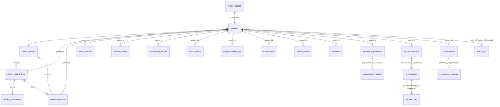

# NEURIX Supabase backend

Project ref: `hhdlsbbeabdbqrlqxtiu`. Every migration in `migrations/` has been applied to
that project (file names match the versions Supabase recorded). `snapshots/` holds the
schema as it was before these migrations. `tests/` holds the security test suite.

## Data model



Composite foreign keys such as `(conversation_id, patient_id)` guarantee that a child row
belongs to the same patient as its parent. `ai_summary_sources.(source_table, source_record_id)`
and `audit_logs.resource_id` are polymorphic on purpose and have no FK; `source_table` is
limited to a fixed list of table names.

## Access model

| Who | What they can do |
|---|---|
| Patient | Full CRUD on their own rows. Cannot see anyone else's rows. |
| Doctor | Read-only, and only when `private.doctor_can_view(patient, category)` is true: verified doctor, approved connection, explicit unrevoked and unexpired grant for that category. |
| Admin | Verifies doctors and manages the admin role via RPC; reads connections, consent and audit records. **No access to clinical data.** |
| anon | Nothing. |

Shareable categories and the tables they unlock:

| Category | Tables |
|---|---|
| `medical_records` | `health_records`, files in the `medical-documents` bucket |
| `medical_history` | `medical_history` |
| `assessments` | `assessment_results` |
| `mood_wellbeing` | `mood_entries` |
| `sleep_habits` | `habit_entries` |
| `lifestyle` | `daily_wellbeing_logs` (note: includes the sleep-hours columns) |
| `wellness_experiments` | `wellness_experiments`, `experiment_checkins` |
| `ai_summaries` | `ai_summaries`, `ai_summary_sources` |

Never shareable: `journal_entries`, `ai_conversations`, `ai_messages`, `ai_memories`, `reminders`.

## RPC functions (call with the user's JWT)

| Function | Caller |
|---|---|
| `find_doctor_by_code(code)` | any signed-in user |
| `request_doctor_connection(code)` | patient |
| `respond_to_connection_request(link_id, accept)` | the verified doctor on that link |
| `revoke_doctor_connection(link_id)` | either party; also revokes every grant on the link |
| `grant_data_access(link_id, category, expires_at?)` | the patient on an approved link |
| `revoke_data_access(link_id, category)` | the patient |
| `admin_verify_doctor(doctor_id, status, note?)` | admin; the only path to the doctor role |
| `admin_set_user_role(user_id, 'patient' \| 'admin')` | admin; the last admin cannot be removed |

Every function writes `consent_records` and/or `audit_logs` rows.

## Becoming a doctor

1. The user inserts their own row into `doctor_profiles` (`specialty`, `registration_number`).
   It is always created as `pending`, whatever the client sends.
2. An admin calls `admin_verify_doctor(id, 'verified')`.

## Bootstrapping the first admin

No user can become admin from the app. Run this once in the SQL editor (as `postgres`)
after the person has signed up:

```sql
update public.profiles set role = 'admin' where id = '<their auth user id>';
```

## Storage

Bucket `medical-documents` is private, 20 MB per file, PDF/JPEG/PNG/WebP/HEIC/text only.
Object path must be `<patient_id>/<file name>`. Owners can read/write their own folder;
doctors can read it with a `medical_records` grant. Store the same path in
`health_records.storage_path`.

## Running the tests

`tests/security_and_integrity_tests.sql` is a single `DO` block. It creates fictional users,
runs 81 checks, and ends by raising an exception containing the report, so everything it
created is rolled back. Last run: 81 passed, 0 failed.

## Keys

The service-role key bypasses RLS. Use it only on the server (e.g. the REST backend),
never in the Next.js client or any `NEXT_PUBLIC_*` variable.
